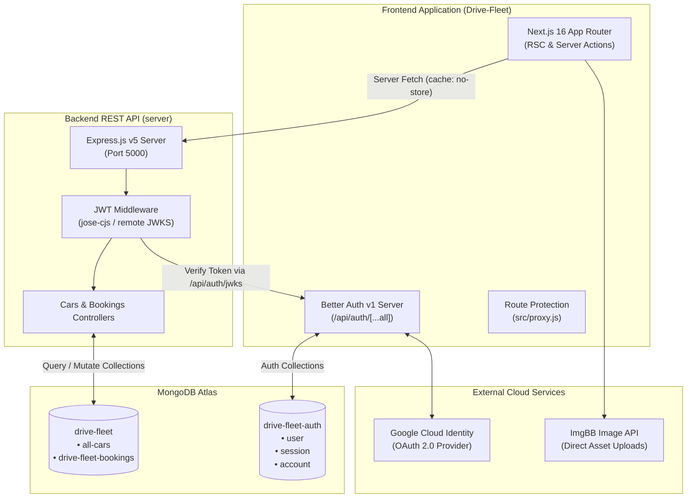

# DriveFleet Documentation Portal

Welcome to the comprehensive technical documentation suite for **DriveFleet**, a full-stack digital car rental platform built with **Next.js 16 (React 19)** and **Node.js / Express.js v5**, backed by **MongoDB Atlas**, **Better Auth**, and **ImgBB**.

---

## 1. Project Introduction and Overview

DriveFleet facilitates vehicle discovery, customer reservations, and host vehicle listing management. The platform delivers a high-performance web experience leveraging React Server Components, client-side interactive dialogs, cryptographic JWT session verification, and cloud media storage.

### Subsystem Architecture



---

## 2. Verified Technology Stack Summary

| Subsystem | Layer | Technology | Verified Version | Purpose |
| --- | --- | --- | --- | --- |
| **Frontend** | Framework | Next.js (App Router) | `16.2.6` | Page routing, server-side rendering, streaming |
| **Frontend** | UI Library | React / React DOM | `19.2.4` | Component architecture and hooks |
| **Frontend** | Styling | Tailwind CSS | `^4` | Utility styling and responsive design |
| **Frontend** | UI Components | DaisyUI / HeroUI | `^5.5.19` / `^3.0.5` | Accessible modals, alerts, tables, form inputs |
| **Frontend** | Identity | Better Auth | `^1.6.11` | Authentication engine, JWT issuer, OAuth |
| **Backend** | Runtime | Node.js (CommonJS) | LTS | Asynchronous server runtime |
| **Backend** | Framework | Express.js | `^5.2.1` | REST API routing and middleware pipeline |
| **Backend** | Driver | MongoDB Driver | `^7.2.0` | Native Atlas client and collection access |
| **Backend** | Security | `jose-cjs` | `^6.2.3` | Cryptographic JWT verification via remote JWKS |
| **External** | Storage | ImgBB Cloud API | v1 | Direct multipart image upload hosting |
| **External** | Identity | Google Cloud Identity | OAuth 2.0 | Social identity provider |

---

## 3. Complete Documentation Suite Index

The documentation suite is structured into dedicated canonical modules:

```
documentation/
├── documentation-portal.md                  # This Documentation Portal & Navigation Gateway
├── README.md                                # Existing Top-Level Documentation Overview (Preserved)
│
├── 01-architecture/
│   ├── system-overview.md                   # System responsibilities, architecture, boundaries
│   ├── frontend-architecture.md             # Next.js App Router, RSC vs Client, UI components
│   └── backend-architecture.md              # Express pipeline, routing, controllers, error handling
│
├── 02-security-and-auth/
│   ├── authentication-flow.md               # Better Auth, registration, login, JWT & JWKS handshake
│   └── route-protection.md                  # Frontend route guards, component checks, API auth matrix
│
├── 03-api-and-contracts/
│   ├── api-reference.md                     # Exhaustive REST API contract for all 10 endpoints
│   └── integration-workflows.md             # End-to-end user journeys and Mermaid sequence diagrams
│
├── 04-database-and-models/
│   ├── data-models.md                       # MongoDB schemas, all-cars, bookings, auth collections
│   └── external-services.md                 # ImgBB API, Google OAuth, image rendering configs
│
└── 05-operations-and-setup/
    ├── environment-configuration.md         # Environment variables, safe placeholders, secrets
    └── developer-handbook.md                # Developer onboarding, prerequisites, setup instructions
```

---

## 4. Canonical Information Ownership

To ensure technical accuracy and avoid contradictory specifications, each major subsystem is owned authoritatively by a designated document:

| Technical Domain | Authoritative Canonical Document | Key Covered Topics |
| --- | --- | --- |
| **System Architecture** | [`01-architecture/system-overview.md`](./01-architecture/system-overview.md) | Distributed topology, runtimes, service boundaries, protocols |
| **Frontend Internals** | [`01-architecture/frontend-architecture.md`](./01-architecture/frontend-architecture.md) | App Router, RSC vs Client breakdown, styling, route mapping |
| **Backend Internals** | [`01-architecture/backend-architecture.md`](./01-architecture/backend-architecture.md) | Express middleware, controller dispatch, error handling |
| **Authentication Flow** | [`02-security-and-auth/authentication-flow.md`](./02-security-and-auth/authentication-flow.md) | Better Auth, Google OAuth, JWT lifecycle, JWKS keys |
| **Route Protection** | [`02-security-and-auth/route-protection.md`](./02-security-and-auth/route-protection.md) | `src/proxy.js`, route matching, backend auth matrix |
| **API Contracts** | [`03-api-and-contracts/api-reference.md`](./03-api-and-contracts/api-reference.md) | Endpoint parameters, schemas, responses, status codes |
| **Integration Workflows** | [`03-api-and-contracts/integration-workflows.md`](./03-api-and-contracts/integration-workflows.md) | End-to-end UI actions, data flow, sequence diagrams |
| **Database Schemas** | [`04-database-and-models/data-models.md`](./04-database-and-models/data-models.md) | MongoDB collections, document structures, ER diagram |
| **External Integrations** | [`04-database-and-models/external-services.md`](./04-database-and-models/external-services.md) | ImgBB image uploads, Google OAuth configuration |
| **Environment Variables** | [`05-operations-and-setup/environment-configuration.md`](./05-operations-and-setup/environment-configuration.md) | Frontend & backend `.env` variables, safe placeholders |
| **Local Development** | [`05-operations-and-setup/developer-handbook.md`](./05-operations-and-setup/developer-handbook.md) | Onboarding, dependencies, startup commands, package scripts |

---

## 5. Suggested Reading Paths

### Path A: New Developer Onboarding

For developers new to the project who need a complete understanding of setup, structure, and execution:

1. Start with the [Developer Handbook](./05-operations-and-setup/developer-handbook.md) to install dependencies and configure local services.
2. Review the [Environment Configuration](./05-operations-and-setup/environment-configuration.md) to set up safe environment files.
3. Read the [System Overview](./01-architecture/system-overview.md) to understand how the frontend, backend, and database interact.
4. Walk through [Integration Workflows](./03-api-and-contracts/integration-workflows.md) to trace real user interactions.

### Path B: Frontend Specialist

For developers focusing on Next.js UI, client interactions, or styling:

1. Read [Frontend Architecture](./01-architecture/frontend-architecture.md) for route groups, RSC vs Client components, and HeroUI.
2. Review [Authentication Flow](./02-security-and-auth/authentication-flow.md) to understand `authClient.token()` and session hooks.
3. Consult [Integration Workflows](./03-api-and-contracts/integration-workflows.md) for modal forms and image upload flows.
4. Reference the [API Reference](./03-api-and-contracts/api-reference.md) for request body requirements.

### Path C: Backend & API Specialist

For developers working on Express endpoints, MongoDB persistence, or security:

1. Read [Backend Architecture](./01-architecture/backend-architecture.md) for server initialization and middleware dispatch.
2. Study the [API Reference](./03-api-and-contracts/api-reference.md) for full route contracts, query filters, and status codes.
3. Inspect [Data Models](./04-database-and-models/data-models.md) for MongoDB collection schemas and field types.
4. Review [Route Protection](./02-security-and-auth/route-protection.md) for `authMiddleware` and JWKS token verification.

---

## 6. Document Preservation and Reference Integrity

In accordance with strict operational standards:

- All pre-existing documentation files (`README.md`, `architecture.md`, `frontend.md`, `backend.md`, `api-reference.md`, `authentication.md`, `data-models.md`, `environment-setup.md`) have been fully preserved without deletion or overwrite.
- The new modular documentation suite is completely self-contained within canonical topic directories (`01-architecture/` through `05-operations-and-setup/`).
